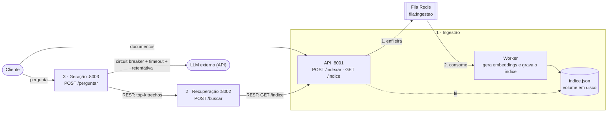

# C2.A2 — RAG Distribuído em Microsserviços

Sistemas Distribuídos e Computação em Nuvem · FAESA · 2026/2

Sistema de perguntas e respostas sobre um conjunto de documentos (RAG: geração aumentada
por recuperação), decomposto em **três microsserviços independentes** que se comunicam por
**REST** e por **fila de mensagens (Redis)**, com a chamada ao LLM protegida por
**circuit breaker, tempo-limite e retentativa**.

> A IA aqui é carga de trabalho, não objeto de avaliação: embeddings TF-IDF (scikit-learn,
> offline) e um cliente de LLM com **modo simulado**, então tudo roda sem internet e sem chave.

## Arquitetura



| Serviço | Responsabilidade | Porta | Comunica por |
|---|---|---|---|
| **Ingestão** (API + worker) | recebe documentos, gera embeddings, mantém o índice persistido | 8001 | API recebe REST e **publica na fila**; o worker **consome a fila** |
| **Recuperação** | dada uma pergunta, devolve os trechos mais parecidos (similaridade do cosseno) | 8002 | REST (lê o índice da ingestão) |
| **Geração** | monta o prompt com os trechos e chama o LLM | 8003 | REST (chama a recuperação) + API do LLM |

Cada serviço tem seu próprio código, `requirements.txt` e `Dockerfile` e **não importa código
dos outros**: só compartilham o pacote `servicos/comum` (vetorização, cliente do LLM e circuit breaker).

### Os dois fluxos

**Indexação (assíncrona, via fila).** `POST /indexar` valida os documentos, coloca-os na fila
Redis e responde `202 Accepted` na hora. O worker tira da fila, gera os embeddings, reindexa
tudo e grava o `indice.json`.

**Pergunta (síncrona, ponta a ponta).** `POST /perguntar` na geração → REST para a recuperação
(`/buscar`) → que lê o índice da ingestão (`/indice`) e ranqueia os trechos → a geração monta o
prompt com os trechos e chama o LLM → responde com a **resposta**, o **contexto** usado e as **fontes**
(os documentos que a embasaram).

## Decisões de projeto

**Mensageria na ingestão.** Gerar embeddings e reindexar custa mais conforme o índice cresce.
Com a fila, quem envia documentos não espera esse trabalho, picos de envio são absorvidos e, se o
worker cair, as mensagens esperam no Redis (que roda com `appendonly`, então a fila também
sobrevive a um reinício do Redis). O worker usa `BLMOVE` para mover cada mensagem para uma lista
"em processamento" e só a apaga **depois** de gravar o índice em disco: entrega *pelo menos uma vez*.
Ao subir, ele devolve à fila o que ficou pendente de uma queda anterior. Reprocessar é seguro porque
o índice ignora documentos repetidos (idempotência por hash de texto + origem). Mensagens
inválidas vão para `fila:ingestao:erros` em vez de travar a fila.

**Persistência do índice.** Arquivo JSON em `DATA_DIR`, com escrita atômica (arquivo temporário +
`os.replace`): quem lê nunca vê um índice pela metade. Em Docker fica em um volume nomeado, então
sobrevive a `docker compose down`/`up`. Há **um único worker escritor**.

**Consistência do vocabulário.** A cada atualização o vocabulário TF-IDF é reajustado com *todos* os
textos e *todos* os vetores são recalculados. A recuperação ajusta um vetorizador com os mesmos textos
e obtém o mesmo vocabulário, então o vetor da pergunta fica no mesmo espaço dos vetores guardados.

**Resiliência na chamada ao LLM** (dependência externa lenta e instável), em camadas:

1. **Tempo-limite:** cada chamada ao LLM tem timeout (`LLM_TIMEOUT`); nunca fica pendurada.
2. **Retentativa:** falhas transitórias (timeout, conexão, 5xx, 408, 429) são repetidas até
   `LLM_TENTATIVAS` vezes com espera crescente (backoff exponencial: 0,5 s, 1 s, 2 s…). Erros 4xx como chave
   inválida não são repetidos, pois não melhoram sozinhos.
3. **Circuit breaker:** cada tentativa passa pelo disjuntor. Após `LLM_LIMITE_FALHAS` falhas seguidas ele
   **abre** e recusa as chamadas na hora (sem esperar timeout) por `LLM_ESPERA_CIRCUITO` segundos; depois
   deixa passar **uma** chamada de teste (meio-aberto) e fecha se ela der certo.
4. **Degradação elegante:** com o LLM fora do ar o serviço **não quebra**: responde `503` com a
   mensagem do problema e `"degradado": true`, e **ainda entrega os trechos recuperados e as fontes**, que
   já respondem a pergunta em parte. Sem chave de API o cliente cai no modo simulado e o sistema continua de pé.

A geração também protege a chamada à recuperação com um segundo disjuntor, e a recuperação responde
`503` se a ingestão estiver fora do ar. `GET /saude` na geração mostra o estado dos dois disjuntores.

## Como executar do zero

### Com Docker (recomendado)

Requisitos: Docker com Compose.

```bash
git clone https://github.com/BiGSerial/sd-2026-2-kit-c2a2.git
cd sd-2026-2-kit-c2a2
cp .env.example .env          # opcional: sem LLM_API_KEY o LLM roda em modo simulado
docker compose up --build -d  # sobe Redis, ingestão (API + worker), recuperação e geração
```

Indexe os documentos de teste e pergunte (precisa de Python 3 com `requests`, ou use os `curl` abaixo):

```bash
python scripts/teste_ponta_a_ponta.py
```

Para parar: `docker compose down` (o índice fica no volume; use `down -v` para apagá-lo).

### Sem Docker (um terminal por processo)

Requisitos: Python 3.11+ e um Redis em `localhost:6379` (por exemplo `docker compose up -d redis` ou `redis-server`).

```bash
python -m venv .venv
source .venv/bin/activate        # Windows: .venv\Scripts\activate
pip install -r requirements.txt

python -m servicos.ingestao.worker                      # terminal 1: worker
uvicorn servicos.ingestao.app:app    --port 8001        # terminal 2
uvicorn servicos.recuperacao.app:app --port 8002        # terminal 3
uvicorn servicos.geracao.app:app     --port 8003        # terminal 4

python scripts/teste_ponta_a_ponta.py                   # terminal 5
```

Para usar um LLM real, exporte a chave **como variável de ambiente** antes de subir a geração
(nunca no código): `export LLM_API_KEY=...` (e, se não for a OpenAI, `LLM_API_URL` e `LLM_MODELO`).

## Usando a API

```bash
# indexar documentos (resposta 202: foram para a fila)
curl -X POST localhost:8001/indexar -H "Content-Type: application/json" \
  -d '[{"texto":"O teorema CAP trata de consistencia e disponibilidade.","origem":"aula11"}]'

# ou indexar todos os .txt de documentos/
python scripts/indexar_documentos.py

# perguntar
curl -X POST localhost:8003/perguntar -H "Content-Type: application/json" \
  -d '{"pergunta":"o que diz o teorema CAP?"}'

# saúde dos serviços (a geração mostra o estado dos disjuntores)
curl localhost:8001/saude   # documentos indexados e tamanho da fila
curl localhost:8003/saude
```

Resposta de `/perguntar`:

```json
{
  "pergunta": "o que diz o teorema CAP?",
  "resposta": "...",
  "contexto": ["trechos usados como base"],
  "fontes": ["teorema_cap", "sistemas_distribuidos"]
}
```

## Testes

**Fluxo de ponta a ponta** (com os serviços no ar): indexa pela fila, espera o worker, pergunta e confere que a
resposta vem dos documentos certos.

```bash
python scripts/teste_ponta_a_ponta.py
```

**Resiliência de verdade**: um LLM falso (`scripts/llm_falso.py`) que pode ficar saudável, quebrado (500) ou lento. O
script derruba e recupera o LLM e confere retentativa, abertura do circuito, recusa imediata, fechamento e tempo-limite.

```bash
docker compose --env-file .env.demo --profile demo up --build -d
python scripts/teste_ponta_a_ponta.py       # indexa os documentos
python scripts/teste_resiliencia.py
docker compose --profile demo down
```

Para acompanhar manualmente: `curl -X POST localhost:9000/modo/erro` quebra o LLM falso (`/modo/ok` e `/modo/lento` o
restauram ou o deixam lento); repita `/perguntar` e veja `docker compose logs geracao` e o campo `disjuntor` em `/saude`.
Você também pode derrubar serviços (`docker compose stop recuperacao`) e observar a degradação.

## Variáveis de ambiente

| Variável | Padrão | Serviço | Efeito |
|---|---|---|---|
| `LLM_API_KEY` | *(vazio)* | geração | vazio = modo simulado; **nunca** vai no código |
| `LLM_API_URL` / `LLM_MODELO` | OpenAI / `gpt-4o-mini` | geração | endpoint e modelo do LLM |
| `LLM_TIMEOUT` | 10 (compose) | geração | tempo-limite por chamada, em segundos |
| `LLM_TENTATIVAS` | 3 | geração | tentativas por pergunta |
| `LLM_BACKOFF` | 0.5 | geração | espera inicial entre tentativas (dobra a cada uma) |
| `LLM_LIMITE_FALHAS` | 3 | geração | falhas seguidas que abrem o circuito |
| `LLM_ESPERA_CIRCUITO` | 20 | geração | segundos com o circuito aberto antes de testar |
| `URL_RECUPERACAO` / `URL_INGESTAO` | `localhost` | geração / recuperação | endereço dos serviços |
| `REDIS_URL` | `redis://localhost:6379/0` | ingestão | broker da fila |
| `DATA_DIR` | `dados` | ingestão | onde fica o `indice.json` |

## Estrutura do projeto

```
.
├── servicos/
│   ├── comum/                  # embeddings (TF-IDF), cliente do LLM, circuit breaker
│   ├── ingestao/               # app.py (API) · worker.py (consumidor da fila) · armazenamento.py (índice em disco)
│   ├── recuperacao/            # app.py (busca por similaridade)
│   └── geracao/                # app.py (prompt, LLM, resiliência)
│       └── (cada serviço com Dockerfile e requirements.txt próprios)
├── documentos/                 # base de teste para indexar
├── scripts/                    # indexar_documentos · teste_ponta_a_ponta · teste_resiliencia · llm_falso
├── docker-compose.yml          # Redis + 3 serviços (+ worker) · perfil "demo" com o LLM falso
└── TAREFAS.md                  # checklist do trabalho
```

## Extensões e limitações

- **Citação de fontes** (extensão opcional): a resposta traz `fontes` com os documentos que a embasaram.
- **Persistência** em disco, em vez de memória (extensão opcional).
- Limitações conhecidas: busca por TF-IDF (lexical, sem sinônimos); a recuperação baixa o índice inteiro a cada
  consulta, adequado ao tamanho do trabalho; um único worker escreve o índice; a fila de erros (`fila:ingestao:erros`)
  é só para inspeção manual.
